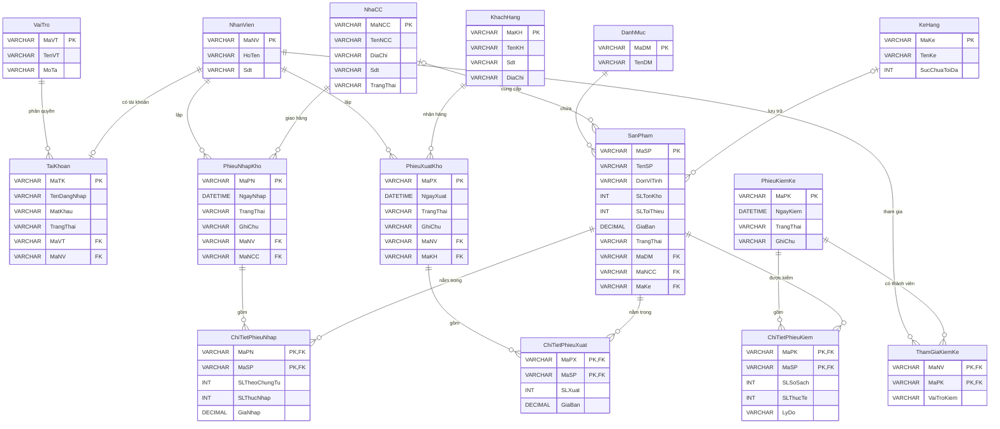

# Tài liệu thiết kế và mô tả cơ sở dữ liệu `quan_ly_kho`

Tài liệu này được trích xuất trực tiếp từ file [init_database.sql](../database/sql/init_database.sql), dùng cho phần thiết kế CSDL trong báo cáo đồ án và làm tài liệu tra cứu tên bảng, tên cột, kiểu dữ liệu, khóa và ràng buộc khi lập trình backend/frontend.

---

## Phần 1. Tổng quan

Cơ sở dữ liệu `quan_ly_kho` gồm **15 bảng**, được chia thành 6 nhóm chức năng:

- **Danh mục:** `DanhMuc`, `KeHang`, `NhaCC`, `KhachHang`
- **Người dùng:** `NhanVien`, `VaiTro`, `TaiKhoan`
- **Hàng hóa:** `SanPham`
- **Nhập kho:** `PhieuNhapKho`, `ChiTietPhieuNhap`
- **Xuất kho:** `PhieuXuatKho`, `ChiTietPhieuXuat`
- **Kiểm kê (tùy chọn):** `PhieuKiemKe`, `ChiTietPhieuKiem`, `ThamGiaKiemKe`

### Danh sách các bảng trong cơ sở dữ liệu

| STT | Tên bảng | Ý nghĩa |
|---|---|---|
| 1 | DanhMuc | Lưu danh mục phân loại các mặt hàng văn phòng phẩm. |
| 2 | KeHang | Lưu thông tin các kệ chứa hàng và sức chứa tối đa trong kho. |
| 3 | NhaCC | Lưu thông tin các nhà cung cấp văn phòng phẩm cho kho. |
| 4 | NhanVien | Lưu thông tin cá nhân của nhân viên làm việc trong hệ thống. |
| 5 | VaiTro | Lưu các vai trò phân quyền sử dụng hệ thống (Admin, Quản lý kho, Nhân viên kho). |
| 6 | TaiKhoan | Lưu tài khoản đăng nhập và phân quyền gắn với từng nhân viên. |
| 7 | SanPham | Lưu thông tin hàng hóa, đơn vị tính, giá bán, tồn kho và vị trí lưu trữ. |
| 8 | KhachHang | Lưu thông tin khách hàng hoặc đơn vị nhận hàng khi xuất kho. |
| 9 | PhieuNhapKho | Lưu thông tin chung của từng phiếu nhập hàng từ nhà cung cấp vào kho. |
| 10 | ChiTietPhieuNhap | Lưu danh sách sản phẩm, số lượng chứng từ, thực nhập và giá nhập trong mỗi phiếu nhập. |
| 11 | PhieuXuatKho | Lưu thông tin chung của từng phiếu xuất hàng từ kho cho khách hàng. |
| 12 | ChiTietPhieuXuat | Lưu danh sách sản phẩm, số lượng xuất và giá bán tại thời điểm xuất trong mỗi phiếu xuất. |
| 13 | PhieuKiemKe | Lưu thông tin chung của các đợt kiểm kê kho (bảng tùy chọn, đề bài không yêu cầu). |
| 14 | ChiTietPhieuKiem | Lưu số lượng sổ sách, số lượng thực tế và lý do chênh lệch của từng sản phẩm khi kiểm kê (bảng tùy chọn). |
| 15 | ThamGiaKiemKe | Lưu danh sách nhân viên tham gia và vai trò trong từng đợt kiểm kê (bảng tùy chọn). |

### Quy ước kiểu dữ liệu SQL → kiểu Java gợi ý

| Kiểu dữ liệu SQL | Kiểu Java gợi ý |
|---|---|
| VARCHAR(n) | String |
| INT | Integer |
| DECIMAL(18,2) | BigDecimal |
| DATETIME | LocalDateTime |

---

## Phần 2. Bảng mô tả chi tiết từng bảng

### 1. Bảng `DanhMuc`
Lưu danh sách các nhóm danh mục sản phẩm văn phòng phẩm.

| STT | Tên cột | Kiểu dữ liệu | Kiểu Java gợi ý | Khóa | Ràng buộc | Mô tả |
|---|---|---|---|---|---|---|
| 1 | MaDM | VARCHAR(20) | String | PK | NOT NULL | Mã danh mục sản phẩm |
| 2 | TenDM | VARCHAR(100) | String | - | - | Tên danh mục sản phẩm |

### 2. Bảng `KeHang`
Lưu thông tin các kệ lưu trữ hàng hóa và sức chứa tối đa trong kho.

| STT | Tên cột | Kiểu dữ liệu | Kiểu Java gợi ý | Khóa | Ràng buộc | Mô tả |
|---|---|---|---|---|---|---|
| 1 | MaKe | VARCHAR(20) | String | PK | NOT NULL | Mã kệ hàng |
| 2 | TenKe | VARCHAR(100) | String | - | - | Tên kệ hàng trong kho |
| 3 | SucChuaToiDa | INT | Integer | - | - | Sức chứa tối đa của kệ |

### 3. Bảng `NhaCC`
Lưu thông tin các nhà cung cấp hàng hóa cho kho.

| STT | Tên cột | Kiểu dữ liệu | Kiểu Java gợi ý | Khóa | Ràng buộc | Mô tả |
|---|---|---|---|---|---|---|
| 1 | MaNCC | VARCHAR(20) | String | PK | NOT NULL | Mã nhà cung cấp |
| 2 | TenNCC | VARCHAR(100) | String | - | - | Tên nhà cung cấp |
| 3 | DiaChi | VARCHAR(255) | String | - | - | Địa chỉ nhà cung cấp |
| 4 | Sdt | VARCHAR(15) | String | - | - | Số điện thoại liên hệ |
| 5 | TrangThai | VARCHAR(50) | String | - | DEFAULT 'Hoạt động' | Trạng thái hợp tác của nhà cung cấp |

**Ghi chú nghiệp vụ:**
- `NhaCC.TrangThai`: nhận giá trị `'Hoạt động'` hoặc `'Ngừng hợp tác'` để thực hiện xóa mềm (không xóa hẳn dòng dữ liệu khỏi CSDL).

### 4. Bảng `NhanVien`
Lưu thông tin cơ bản của nhân viên làm việc tại kho.

| STT | Tên cột | Kiểu dữ liệu | Kiểu Java gợi ý | Khóa | Ràng buộc | Mô tả |
|---|---|---|---|---|---|---|
| 1 | MaNV | VARCHAR(20) | String | PK | NOT NULL | Mã nhân viên |
| 2 | HoTen | VARCHAR(100) | String | - | - | Họ và tên nhân viên |
| 3 | Sdt | VARCHAR(15) | String | - | - | Số điện thoại nhân viên |

### 5. Bảng `VaiTro`
Lưu danh sách các vai trò phân quyền trong hệ thống.

| STT | Tên cột | Kiểu dữ liệu | Kiểu Java gợi ý | Khóa | Ràng buộc | Mô tả |
|---|---|---|---|---|---|---|
| 1 | MaVT | VARCHAR(20) | String | PK | NOT NULL | Mã vai trò |
| 2 | TenVT | VARCHAR(100) | String | - | NOT NULL, UNIQUE | Tên vai trò (Admin, Quản lý kho, Nhân viên kho) |
| 3 | MoTa | VARCHAR(255) | String | - | - | Mô tả chức năng, quyền hạn của vai trò |

### 6. Bảng `TaiKhoan`
Lưu thông tin tài khoản đăng nhập hệ thống của từng nhân viên.

| STT | Tên cột | Kiểu dữ liệu | Kiểu Java gợi ý | Khóa | Ràng buộc | Mô tả |
|---|---|---|---|---|---|---|
| 1 | MaTK | VARCHAR(20) | String | PK | NOT NULL | Mã tài khoản |
| 2 | TenDangNhap | VARCHAR(50) | String | - | NOT NULL, UNIQUE | Tên đăng nhập duy nhất |
| 3 | MatKhau | VARCHAR(255) | String | - | NOT NULL | Mật khẩu đã mã hóa |
| 4 | TrangThai | VARCHAR(50) | String | - | DEFAULT 'Hoạt động' | Trạng thái tài khoản ('Hoạt động' / 'Bị khóa') |
| 5 | MaVT | VARCHAR(20) | String | FK → VaiTro(MaVT) | NOT NULL | Mã vai trò được gán cho tài khoản |
| 6 | MaNV | VARCHAR(20) | String | FK → NhanVien(MaNV) | NOT NULL, UNIQUE | Mã nhân viên sở hữu tài khoản |

**Ghi chú nghiệp vụ:**
- `TaiKhoan.MatKhau`: lưu mã băm SHA-256, không lưu mật khẩu thật (dữ liệu mẫu dùng `SHA2('123456', 256)`).
- `TaiKhoan.MaNV` có ràng buộc `UNIQUE` nên mỗi nhân viên chỉ gắn với một tài khoản (quan hệ 1-1 với `NhanVien`).
- `TaiKhoan.TrangThai`: `'Hoạt động'` / `'Bị khóa'`.

### 7. Bảng `SanPham`
Lưu thông tin hàng hóa văn phòng phẩm, tồn kho, giá bán và phân loại.

| STT | Tên cột | Kiểu dữ liệu | Kiểu Java gợi ý | Khóa | Ràng buộc | Mô tả |
|---|---|---|---|---|---|---|
| 1 | MaSP | VARCHAR(20) | String | PK | NOT NULL | Mã sản phẩm |
| 2 | TenSP | VARCHAR(100) | String | - | - | Tên sản phẩm |
| 3 | DonViTinh | VARCHAR(20) | String | - | - | Đơn vị tính (Cây, Ream, Quyển, Hộp, Cái...) |
| 4 | SLTonKho | INT | Integer | - | DEFAULT 0, CHECK (SLTonKho >= 0) | Số lượng tồn kho hiện tại |
| 5 | SLToiThieu | INT | Integer | - | DEFAULT 10, CHECK (SLToiThieu >= 0) | Ngưỡng tồn kho tối thiểu |
| 6 | GiaBan | DECIMAL(18,2) | BigDecimal | - | CHECK (GiaBan > 0) | Giá bán hiện hành của sản phẩm |
| 7 | TrangThai | VARCHAR(50) | String | - | DEFAULT 'Đang kinh doanh' | Trạng thái kinh doanh của sản phẩm |
| 8 | MaDM | VARCHAR(20) | String | FK → DanhMuc(MaDM) | NOT NULL | Mã danh mục chứa sản phẩm |
| 9 | MaNCC | VARCHAR(20) | String | FK → NhaCC(MaNCC) | - | Mã nhà cung cấp (có thể NULL) |
| 10 | MaKe | VARCHAR(20) | String | FK → KeHang(MaKe) | - | Mã kệ hàng lưu trữ (có thể NULL) |

**Ghi chú nghiệp vụ:**
- `SanPham.TrangThai`: nhận giá trị `'Đang kinh doanh'` hoặc `'Ngừng kinh doanh'` để thực hiện xóa mềm.
- `SLTonKho` không được phép âm (`CHECK (SLTonKho >= 0)`), tăng khi nhập kho và giảm khi xuất kho.

### 8. Bảng `KhachHang`
Lưu thông tin khách hàng hoặc đơn vị nhận hàng khi xuất kho.

| STT | Tên cột | Kiểu dữ liệu | Kiểu Java gợi ý | Khóa | Ràng buộc | Mô tả |
|---|---|---|---|---|---|---|
| 1 | MaKH | VARCHAR(20) | String | PK | NOT NULL | Mã khách hàng |
| 2 | TenKH | VARCHAR(100) | String | - | - | Tên khách hàng hoặc đơn vị |
| 3 | Sdt | VARCHAR(15) | String | - | - | Số điện thoại khách hàng |
| 4 | DiaChi | VARCHAR(255) | String | - | - | Địa chỉ khách hàng |

### 9. Bảng `PhieuNhapKho`
Lưu thông tin tổng quát của mỗi phiếu nhập hàng vào kho.

| STT | Tên cột | Kiểu dữ liệu | Kiểu Java gợi ý | Khóa | Ràng buộc | Mô tả |
|---|---|---|---|---|---|---|
| 1 | MaPN | VARCHAR(20) | String | PK | NOT NULL | Mã phiếu nhập kho |
| 2 | NgayNhap | DATETIME | LocalDateTime | - | DEFAULT CURRENT_TIMESTAMP | Ngày giờ lập phiếu nhập |
| 3 | TrangThai | VARCHAR(50) | String | - | DEFAULT 'Hoàn thành' | Trạng thái phiếu ('Hoàn thành' / 'Hủy') |
| 4 | GhiChu | VARCHAR(255) | String | - | - | Ghi chú của phiếu nhập |
| 5 | MaNV | VARCHAR(20) | String | FK → NhanVien(MaNV) | NOT NULL | Mã nhân viên lập phiếu nhập |
| 6 | MaNCC | VARCHAR(20) | String | FK → NhaCC(MaNCC) | NOT NULL | Mã nhà cung cấp giao hàng |

**Ghi chú nghiệp vụ:**
- `PhieuNhapKho.TrangThai`: `'Hoàn thành'` / `'Hủy'`. Nếu hủy phiếu nhập đã hoàn thành thì phải giảm lại `SLTonKho` tương ứng.
- `NgayNhap`: dùng để lọc và thống kê lịch sử nhập kho theo tháng, năm.

### 10. Bảng `ChiTietPhieuNhap`
Lưu chi tiết từng sản phẩm và số lượng trong mỗi phiếu nhập kho.

| STT | Tên cột | Kiểu dữ liệu | Kiểu Java gợi ý | Khóa | Ràng buộc | Mô tả |
|---|---|---|---|---|---|---|
| 1 | MaPN | VARCHAR(20) | String | PK, FK → PhieuNhapKho(MaPN) | NOT NULL | Mã phiếu nhập kho |
| 2 | MaSP | VARCHAR(20) | String | PK, FK → SanPham(MaSP) | NOT NULL | Mã sản phẩm được nhập |
| 3 | SLTheoChungTu | INT | Integer | - | DEFAULT 0, CHECK (SLTheoChungTu >= 0) | Số lượng ghi trên giấy tờ của nhà cung cấp |
| 4 | SLThucNhap | INT | Integer | - | DEFAULT 0, CHECK (SLThucNhap >= 0) | Số lượng đếm thực tế khi nhập kho |
| 5 | GiaNhap | DECIMAL(18,2) | BigDecimal | - | CHECK (GiaNhap >= 0) | Đơn giá nhập kho |

**Ghi chú nghiệp vụ:**
- `SLThucNhap` (đếm thực tế) mới là số lượng dùng để tăng tồn kho (`SanPham.SLTonKho`); `SLTheoChungTu` chỉ là số ghi trên giấy tờ của nhà cung cấp để đối chiếu.

### 11. Bảng `PhieuXuatKho`
Lưu thông tin tổng quát của mỗi phiếu xuất hàng ra khỏi kho.

| STT | Tên cột | Kiểu dữ liệu | Kiểu Java gợi ý | Khóa | Ràng buộc | Mô tả |
|---|---|---|---|---|---|---|
| 1 | MaPX | VARCHAR(20) | String | PK | NOT NULL | Mã phiếu xuất kho |
| 2 | NgayXuat | DATETIME | LocalDateTime | - | DEFAULT CURRENT_TIMESTAMP | Ngày giờ lập phiếu xuất |
| 3 | TrangThai | VARCHAR(50) | String | - | DEFAULT 'Hoàn thành' | Trạng thái phiếu ('Hoàn thành' / 'Hủy') |
| 4 | GhiChu | VARCHAR(255) | String | - | - | Ghi chú của phiếu xuất |
| 5 | MaNV | VARCHAR(20) | String | FK → NhanVien(MaNV) | NOT NULL | Mã nhân viên lập phiếu xuất |
| 6 | MaKH | VARCHAR(20) | String | FK → KhachHang(MaKH) | NOT NULL | Mã khách hàng nhận hàng |

**Ghi chú nghiệp vụ:**
- `PhieuXuatKho.TrangThai`: `'Hoàn thành'` / `'Hủy'`. Nếu hủy phiếu xuất đã hoàn thành thì phải cộng trả lại `SLTonKho` tương ứng.

### 12. Bảng `ChiTietPhieuXuat`
Lưu chi tiết từng sản phẩm, số lượng xuất và đơn giá bán trong mỗi phiếu xuất kho.

| STT | Tên cột | Kiểu dữ liệu | Kiểu Java gợi ý | Khóa | Ràng buộc | Mô tả |
|---|---|---|---|---|---|---|
| 1 | MaPX | VARCHAR(20) | String | PK, FK → PhieuXuatKho(MaPX) | NOT NULL | Mã phiếu xuất kho |
| 2 | MaSP | VARCHAR(20) | String | PK, FK → SanPham(MaSP) | NOT NULL | Mã sản phẩm được xuất |
| 3 | SLXuat | INT | Integer | - | NOT NULL, CHECK (SLXuat > 0) | Số lượng sản phẩm xuất kho |
| 4 | GiaBan | DECIMAL(18,2) | BigDecimal | - | - | Giá bán lúc xuất (lấy từ `SanPham.GiaBan`) |

**Ghi chú nghiệp vụ:**
- `ChiTietPhieuXuat.GiaBan`: lưu giá bán tại thời điểm xuất kho (lấy từ `SanPham.GiaBan` lúc lập phiếu).
- Khi lập phiếu xuất, `SanPham.SLTonKho` giảm theo `SLXuat` và không cho xuất vượt quá số lượng đang tồn.

### 13. Bảng `PhieuKiemKe` *(tùy chọn)*
Lưu thông tin chung của từng đợt kiểm kê hàng hóa trong kho.

| STT | Tên cột | Kiểu dữ liệu | Kiểu Java gợi ý | Khóa | Ràng buộc | Mô tả |
|---|---|---|---|---|---|---|
| 1 | MaPK | VARCHAR(20) | String | PK | NOT NULL | Mã phiếu kiểm kê |
| 2 | NgayKiem | DATETIME | LocalDateTime | - | DEFAULT CURRENT_TIMESTAMP | Ngày giờ kiểm kê |
| 3 | TrangThai | VARCHAR(50) | String | - | DEFAULT 'Hoàn thành' | Trạng thái phiếu kiểm kê |
| 4 | GhiChu | VARCHAR(255) | String | - | - | Ghi chú đợt kiểm kê |

**Ghi chú nghiệp vụ:**
- Bảng thuộc nhóm kiểm kê (**tùy chọn, đề bài không yêu cầu**, có thể bỏ nếu thiếu thời gian).

### 14. Bảng `ChiTietPhieuKiem` *(tùy chọn)*
Lưu kết quả đối chiếu số lượng sổ sách và số lượng thực tế của từng sản phẩm khi kiểm kê.

| STT | Tên cột | Kiểu dữ liệu | Kiểu Java gợi ý | Khóa | Ràng buộc | Mô tả |
|---|---|---|---|---|---|---|
| 1 | MaPK | VARCHAR(20) | String | PK, FK → PhieuKiemKe(MaPK) | NOT NULL | Mã phiếu kiểm kê |
| 2 | MaSP | VARCHAR(20) | String | PK, FK → SanPham(MaSP) | NOT NULL | Mã sản phẩm được kiểm kê |
| 3 | SLSoSach | INT | Integer | - | NOT NULL, CHECK (SLSoSach >= 0) | Số lượng trên sổ sách tại thời điểm kiểm |
| 4 | SLThucTe | INT | Integer | - | - | Số lượng đếm thực tế |
| 5 | LyDo | VARCHAR(255) | String | - | - | Lý do chênh lệch (nếu có) |

**Ghi chú nghiệp vụ:**
- Bảng thuộc nhóm kiểm kê (**tùy chọn, đề bài không yêu cầu**, có thể bỏ nếu thiếu thời gian).

### 15. Bảng `ThamGiaKiemKe` *(tùy chọn)*
Lưu danh sách nhân viên tham gia và vai trò trong từng phiếu kiểm kê.

| STT | Tên cột | Kiểu dữ liệu | Kiểu Java gợi ý | Khóa | Ràng buộc | Mô tả |
|---|---|---|---|---|---|---|
| 1 | MaNV | VARCHAR(20) | String | PK, FK → NhanVien(MaNV) | NOT NULL | Mã nhân viên tham gia kiểm kê |
| 2 | MaPK | VARCHAR(20) | String | PK, FK → PhieuKiemKe(MaPK) | NOT NULL | Mã phiếu kiểm kê |
| 3 | VaiTroKiem | VARCHAR(100) | String | - | - | Vai trò của nhân viên khi kiểm kê |

**Ghi chú nghiệp vụ:**
- Bảng thuộc nhóm kiểm kê (**tùy chọn, đề bài không yêu cầu**, có thể bỏ nếu thiếu thời gian).

---

## Phần 3. Lược đồ quan hệ dạng chữ

Quy ước: cột gạch dưới (`<u>...</u>`) là khóa chính, cột có dấu `#` phía trước là khóa ngoại. Thứ tự cột giữ nguyên theo `init_database.sql`.

1. DanhMuc(<u>MaDM</u>, TenDM)
2. KeHang(<u>MaKe</u>, TenKe, SucChuaToiDa)
3. NhaCC(<u>MaNCC</u>, TenNCC, DiaChi, Sdt, TrangThai)
4. NhanVien(<u>MaNV</u>, HoTen, Sdt)
5. VaiTro(<u>MaVT</u>, TenVT, MoTa)
6. TaiKhoan(<u>MaTK</u>, TenDangNhap, MatKhau, TrangThai, #MaVT, #MaNV)
7. SanPham(<u>MaSP</u>, TenSP, DonViTinh, SLTonKho, SLToiThieu, GiaBan, TrangThai, #MaDM, #MaNCC, #MaKe)
8. KhachHang(<u>MaKH</u>, TenKH, Sdt, DiaChi)
9. PhieuNhapKho(<u>MaPN</u>, NgayNhap, TrangThai, GhiChu, #MaNV, #MaNCC)
10. ChiTietPhieuNhap(#<u>MaPN</u>, #<u>MaSP</u>, SLTheoChungTu, SLThucNhap, GiaNhap)
11. PhieuXuatKho(<u>MaPX</u>, NgayXuat, TrangThai, GhiChu, #MaNV, #MaKH)
12. ChiTietPhieuXuat(#<u>MaPX</u>, #<u>MaSP</u>, SLXuat, GiaBan)
13. PhieuKiemKe(<u>MaPK</u>, NgayKiem, TrangThai, GhiChu) *(tùy chọn)*
14. ChiTietPhieuKiem(#<u>MaPK</u>, #<u>MaSP</u>, SLSoSach, SLThucTe, LyDo) *(tùy chọn)*
15. ThamGiaKiemKe(#<u>MaNV</u>, #<u>MaPK</u>, VaiTroKiem) *(tùy chọn)*

---

## Phần 4. Bảng liệt kê khóa ngoại (quan hệ giữa các bảng)

Tổng hợp đầy đủ 17 khóa ngoại từ các câu lệnh `FOREIGN KEY` trong `init_database.sql`:

| STT | Bảng con | Cột khóa ngoại | Bảng cha | Cột được tham chiếu | Quan hệ | Ghi chú |
|---|---|---|---|---|---|---|
| 1 | TaiKhoan | MaVT | VaiTro | MaVT | 1-N | bắt buộc |
| 2 | TaiKhoan | MaNV | NhanVien | MaNV | 1-1 | bắt buộc |
| 3 | SanPham | MaDM | DanhMuc | MaDM | 1-N | bắt buộc |
| 4 | SanPham | MaNCC | NhaCC | MaNCC | 1-N | có thể NULL |
| 5 | SanPham | MaKe | KeHang | MaKe | 1-N | có thể NULL |
| 6 | PhieuNhapKho | MaNV | NhanVien | MaNV | 1-N | bắt buộc |
| 7 | PhieuNhapKho | MaNCC | NhaCC | MaNCC | 1-N | bắt buộc |
| 8 | ChiTietPhieuNhap | MaPN | PhieuNhapKho | MaPN | 1-N | bắt buộc |
| 9 | ChiTietPhieuNhap | MaSP | SanPham | MaSP | 1-N | bắt buộc |
| 10 | PhieuXuatKho | MaNV | NhanVien | MaNV | 1-N | bắt buộc |
| 11 | PhieuXuatKho | MaKH | KhachHang | MaKH | 1-N | bắt buộc |
| 12 | ChiTietPhieuXuat | MaPX | PhieuXuatKho | MaPX | 1-N | bắt buộc |
| 13 | ChiTietPhieuXuat | MaSP | SanPham | MaSP | 1-N | bắt buộc |
| 14 | ChiTietPhieuKiem | MaPK | PhieuKiemKe | MaPK | 1-N | bắt buộc |
| 15 | ChiTietPhieuKiem | MaSP | SanPham | MaSP | 1-N | bắt buộc |
| 16 | ThamGiaKiemKe | MaNV | NhanVien | MaNV | 1-N | bắt buộc |
| 17 | ThamGiaKiemKe | MaPK | PhieuKiemKe | MaPK | 1-N | bắt buộc |

*(Lưu ý: Quan hệ giữa `NhanVien` và `TaiKhoan` là 1-1 vì cột `TaiKhoan.MaNV` có ràng buộc `UNIQUE`.)*

---

## Phần 5. Sơ đồ quan hệ thực thể (ER) bằng Mermaid

**Hướng dẫn xuất sơ đồ để chèn vào Word:**
1. Dán đoạn code trong khối `mermaid` ở trên vào trang https://mermaid.live.
2. Bấm **Download PNG** hoặc **Download SVG** để lưu ảnh sơ đồ về máy.
3. Chèn file ảnh vừa tải vào báo cáo Word.

GitHub tự vẽ sơ đồ này khi mở file trên web.
